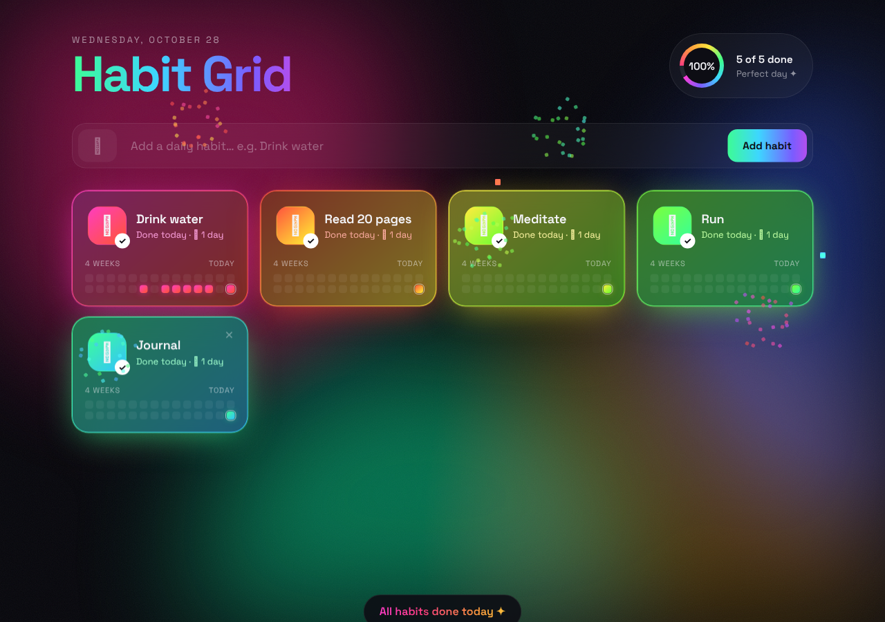

# Habit Grid

A habit tracker with a dark rainbow look. Add your daily habits, then tap a tile each time you do one.



## Features

- **Habit tiles:** each habit gets an emoji and its own rainbow color.
- **One tap to check off:** tapping a tile marks it done for today, with a confetti burst and a glow.
- **Streaks:** each tile shows how many days in a row you've done it.
- **4-week history:** click any square in a tile's grid to mark or unmark a past day.
- **Daily progress ring:** fills up as you go, and you get a celebration when every habit is done.
- **Saved locally:** all data stays in your browser's `localStorage`. No account and no server.

## Run it

It's a single HTML file with no build step or dependencies. Open `index.html` in a browser, or serve the folder:

```bash
python3 -m http.server 8080
# then open http://localhost:8080
```

## Usage

1. Type a habit name, and optionally an emoji, then press **Add habit**.
2. Tap a tile when you've done that habit today. Tap it again to undo.
3. Hover over a tile and click **✕** to delete it.
